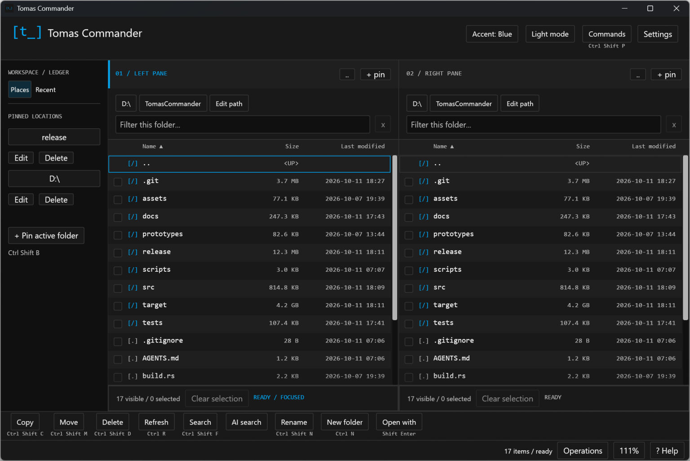

# Tomas Commander

My personal, made-to-measure file manager for the modern era: a standalone
Windows application built in Rust, with a native UI and a goal of being very
fast, lightweight and keyboard-first.

Inspired by Total Commander and Norton Commander, it brings two-pane file work,
in-app reading and editing, and developer/agent launchers into one clean,
terminal-inspired workspace. No browser engine, WebView or JavaScript runtime.
AI commands and more AI-assisted workflows are part of the direction; the
existing AI integrations are limited experiments, not general-purpose agents.

**Use entirely at your own risk. This is a personal project with zero support
and no guarantees. Developed with GitHub Copilot; 0% of the code has been
reviewed by a human. Back up your files before using it.**



Actual v0.1.0 application screenshot; the displayed folder listing was captured
before the release cleanup.

## Download and run

Download `tomas-commander.exe` from [GitHub Releases](https://github.com/tkubica12/TomasCommander/releases).
The latest version is **v0.2.0**, an experimental Windows x64 release.
No installer or Rust toolchain is needed to run the downloaded executable.
The binary is unsigned; this project does not provide code-signing or support.

```powershell
.\tomas-commander.exe
# Optional initial folder:
.\tomas-commander.exe --root "C:\Projects"
```

## Features

- Two file panes, keyboard navigation, multi-selection, filtering, recursive
  filename search and sortable size/date columns.
- Copy, same-volume move, Recycle Bin deletion, rename and new folder, with
  exact-path confirmation and durable operation receipts.
- Saved locations with editable names and removal, recent documents, compact
  clickable breadcrumbs and inline filename editing.
- Native previews for Markdown, semantic HTML, PDF, JPEG/PNG/BMP, UTF-8
  text/config/source files, formatted JSON and comma-delimited CSV.
- Source editing with guarded Save; ZIP browsing, creation, insertion and
  extraction with reviewed operation plans.
- Command palette and Open with choices for VS Code, GitHub Copilot CLI and
  GitHub Copilot App, when installed.
- Light/dark mode, four accent choices, proportional UI zoom and internal
  drag-and-drop: Move by default, Ctrl for Copy.

## Keyboard essentials

| Shortcut | Action |
|---|---|
| Tab / arrows | Switch pane / navigate |
| Enter / Backspace | Open / parent folder |
| Ctrl+Left / Ctrl+Right | Parent / return after parent navigation |
| Ctrl+Up / Ctrl+Down | Jump ten rows |
| Space / Shift+arrows / Ctrl+A | Toggle / range / select all |
| Ctrl+Enter | Toggle preview; a different file replaces it |
| Shift+Enter | Open with menu |
| Ctrl+Shift+P | Command palette |
| Alt+Up | Saved places, including Add current folder |
| Ctrl+F / Ctrl+Shift+F | Filter / recursive filename search |
| Ctrl+Shift+C / Ctrl+Shift+M / Ctrl+Shift+D | Copy / move / Recycle Bin |
| Ctrl+N / Ctrl+Shift+N | New folder / rename |
| Ctrl+plus / Ctrl+minus / Ctrl+wheel | Global UI zoom |
| Ctrl+0 | Reset zoom |
| ? / status-bar Help | Shortcut help |

Typing in a file pane goes directly into its filter. Down from the filter
focuses the first matching file; further arrows navigate the list. Escape clears
the filter from the field or file list.
The command palette has multiline input and slash actions such as `/rename`
and `/preview`, alongside command-name filtering. Enter runs; Shift+Enter
inserts a newline. `/ai-search your prompt` uses the existing bounded AI search.
The workspace rail starts collapsed; expand it with `>` or the places/recent
keyboard shortcuts. See [release notes](CHANGELOG.md) for version history.

No function keys or Z/Y bindings are required. Mouse access remains available.
At a drive root, opening `..`, Backspace, Ctrl+Left or the header's `..` button
opens the Windows drive chooser. Use Up/Down and Enter, or click a drive;
Escape cancels. The chosen drive replaces only the active pane. Unavailable
or disconnected drives report an ordinary folder-read error.
Single-click a filename to edit it in place; Enter reviews the rename and
Escape cancels. Double-click opens normally; Ctrl-double-click previews and
Shift-double-click opens the chooser.

Preferences, saved-location names and appearance persist in
`%LOCALAPPDATA%\TomasCommander\preferences.txt`.

## Important limits

Confirmations are safeguards, not a guarantee against data loss. Ordinary file
operations do not overwrite or merge existing destinations. Cancellation can
leave partial outputs; inspect **Operations** before retrying. Copy does not
preserve all Windows metadata, ACLs or alternate streams. Cross-volume moves
are not supported.

HTML previews are semantic, not full CSS/browser rendering; scripts and external
assets are not loaded. ZIP support is limited to Store/Deflate and excludes
encrypted, split and ZIP64 archives. Voice, remappable shortcuts and external
Explorer drag-and-drop are not implemented. Broad hardware, performance,
accessibility and physical CZ/US keyboard acceptance are not complete.

Copilot CLI is launched with `--yolo`, allowing that external agent to act
without its usual permission prompts. Only use it in a folder you trust.

Foundry prompt-only interpretation/search/file-command pilots require your own
explicit configuration, consent and existing Azure CLI sign-in. They have
durable attempt limits and no automatic retries. Connected WebIQ answers have
an experimental app-side implementation but no completed live acceptance;
WorkIQ is not a working integration. AI data/budget boundaries are described
in [AI runtime](docs/decisions/ai-runtime.md) and
[connected answers](docs/decisions/connected-answers.md).

## Build from source

Windows, Rust 1.95+ and Visual Studio 2022 Build Tools with C++/Windows SDK
are required.

```powershell
.\scripts\build.ps1
.\release\tomas-commander.exe --root "C:\Projects"
```

`release\tomas-commander.exe` is the single current local executable. `release`
and Cargo's `target` cache are gitignored; published versions live in GitHub
Releases. Close the local app before rebuilding. A failed build/publication
preserves the previous executable.

```powershell
cargo test --locked
cargo test --locked --all-features
cargo clippy --locked --all-targets --all-features -- -D warnings
cargo fmt --all -- --check
.\tests\build-workflow.ps1
```

Diagnostic features are nonshipping. Build them only with
`.\scripts\build.ps1 -Mode Diagnostic -Features native-desktop-tests`, then
close the diagnostic process and run
`.\scripts\build.ps1 -Mode CleanDiagnostic`.

The existing local WinHTTP timeout regression is intermittent under a broad
parallel test run; an isolated rerun can pass. This is a known validation limit,
not evidence that the full suite is consistently green.

[Usage and format limits](docs/usage.md) ·
[Architecture](docs/decisions/desktop-shell.md) ·
[File-operation policy](docs/decisions/file-operations.md) ·
[Roadmap](docs/roadmap.md) · [Release notes](CHANGELOG.md)

Licensed under [MIT](LICENSE).
